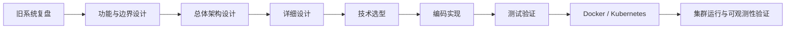

# EDI Nexus

EDI Nexus 是一套准备重新设计和实现的企业级 EDI / Data Exchange（数据交换）平台。

这个项目的目标不是先写代码，而是先把“要做什么、为什么这么做、系统应该怎么组织”设计清楚，再进入技术选型、开发和测试。

## 当前阶段

当前处于：**功能与边界设计准备阶段**。

## 项目设计原则

1. 先需求，后架构，再技术，最后代码。
2. 项目设计者本人是文档第一读者，AI / Codex 是第二读者。
3. 文档优先讲清楚“为什么”和“怎么理解”，不追求堆砌术语。
4. 重要设计尽量使用“文字 + 图”共同表达。
5. 没有确定的内容明确写“未确定”，不为了完整而猜。
6. 重要架构决策单独记录原因，避免以后只记得结果、不记得为什么。
7. 每次重要讨论结束后更新总体设计和当前设计上下文。
8. 测试要求在设计阶段就开始考虑，不等全部代码写完再补。

## 文档入口

- [EDI Nexus 总体设计](docs/00-EDI-Nexus-总体设计.md)
- [当前设计上下文](docs/01-当前设计上下文.md)
- [设计与文档协作约定](docs/02-设计与文档协作约定.md)
- [旧版 Data Exchange 架构复盘摘要](docs/legacy/00-旧版架构复盘摘要.md)
- [ADR-0001：文档优先与持续记录](docs/decisions/ADR-0001-文档优先与持续记录.md)

## 当前还没有决定的内容

以下内容后续根据功能和架构逐步决定：

- 最终模块划分
- 是否拆成微服务
- Java / Spring Boot 最终版本
- Kafka、Redis、PostgreSQL 等技术的最终使用方式
- 是否使用 Apache Camel
- Kubernetes 最终部署方式
- 日志、监控、链路追踪组件的最终技术选型

> 当前仓库先以设计文档为主。进入编码阶段后，再逐步加入应用代码、测试、容器和 Kubernetes 相关内容。
