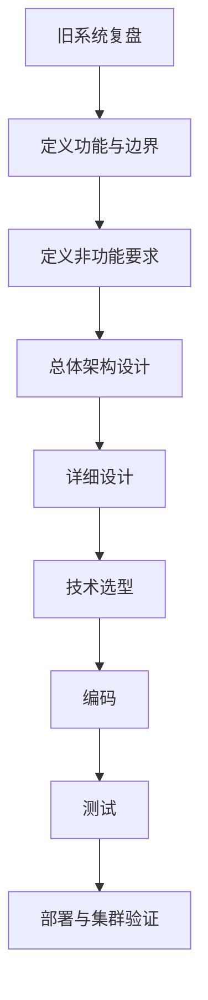
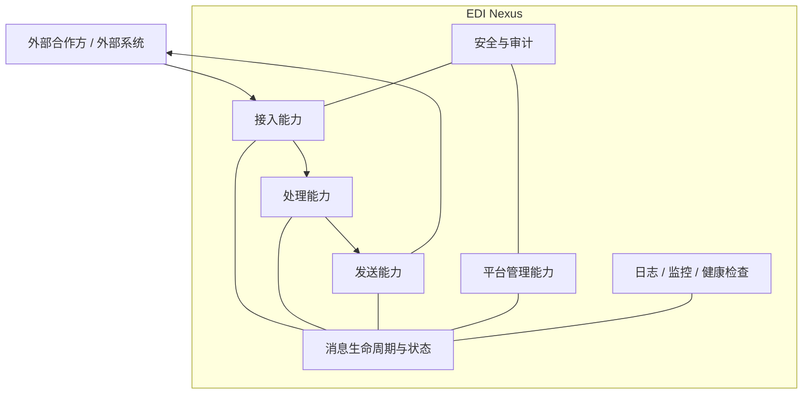

# EDI Nexus 总体设计

> 这份文档是 EDI Nexus 的“总地图”。  
> 它只维护大的方向、边界和当前结论，不在这里堆太多实现细节。  
> 详细内容会拆到对应专题文档中。

## 1. 项目目标

重新设计一套比旧版更成熟、更容易维护和扩展的企业数据交换平台。

平台未来需要逐步具备：

- 外部数据接入
- 数据解析与校验
- 数据转换
- 路由与分发
- 对外发送
- 消息状态跟踪
- 失败处理与重试
- 管理平台
- 日志与监控
- 健康检查
- 操作审计
- 容器化部署
- Kubernetes 多实例运行
- 集群故障与恢复测试

## 2. 当前设计方法

本项目固定按照下面的顺序推进：



核心原则：

> 需求决定架构，架构决定技术，技术服务于实现。

## 3. 当前总体能力地图（第一版）

这张图只是第一版能力地图，后续会持续调整。



### 3.1 接入能力

当前只定义方向，细节尚未确定：

- 谁可以向平台发送数据
- 支持哪些接入方式
- 如何识别合作方
- 如何认证
- 如何保存原始消息
- 接收成功到底代表什么

### 3.2 处理能力

未来需要讨论：

- 报文解析
- 基础校验
- 业务校验
- 数据转换
- 标准内部消息模型
- 路由规则
- 幂等
- 处理状态

### 3.3 发送能力

未来需要讨论：

- 发送目标
- 发送协议
- 同步 / 异步
- 超时
- 重试
- 最终失败
- 回执
- 人工重发

### 3.4 平台管理能力

未来管理平台至少需要讨论：

- Partner / 合作方管理
- 接入通道管理
- 路由规则管理
- 消息查询
- 消息生命周期查看
- 失败消息查看
- 人工重试
- 配置管理
- 操作审计

### 3.5 可观测与运行能力

从设计初期就需要考虑：

- 日志
- 指标
- 链路追踪
- 健康检查
- 告警
- Kubernetes Pod 状态
- Kafka 等中间件状态
- 外部 Partner 连接状态

这里要区分：

- **业务管理平台**：看“某条 EDI 消息发生了什么”
- **技术监控平台**：看“系统运行得怎么样”

## 4. 当前已确认的设计方向

### 4.1 保留旧版的设计思想

旧版中值得保留的是“思想”，不是原样复制代码：

- 接收与业务处理分离
- 外部报文先转成统一内部消息
- 按合作方 / 场景 / 版本隔离差异
- 业务校验与系统校验分离
- 处理流程有明确阶段
- 异步解耦思想
- 处理结果能够回流并被追踪

### 4.2 新版必须重点解决的问题

新版需要重点解决：

- 明确的消息生命周期
- 成功 / 失败语义
- 幂等
- 数据一致性
- 可恢复性
- 多 Pod 并发
- Pod 中途终止
- 消息重复消费
- 日志和消息关联
- 失败消息可定位、可重试、可审计

## 5. 当前尚未决定

以下内容暂时不提前下结论：

- 单体还是微服务
- 拆几个服务
- Kafka 是否用于每个处理阶段
- Redis 是否必须使用
- 数据库最终结构
- Java 和 Spring Boot 最终版本
- 是否使用 Apache Camel
- 监控组件的最终组合
- 部署拓扑

这些问题需要等功能边界清楚之后再决定。

## 6. 文档体系

```text
docs/
├── 00-EDI-Nexus-总体设计.md
├── 01-当前设计上下文.md
├── 02-设计与文档协作约定.md
├── legacy/
├── functional-design/
├── architecture/
├── detailed-design/
├── decisions/
├── technology/
├── testing/
└── deployment/
```

详细目录按实际需要逐步创建，不为了目录完整提前制造空文档。

## 7. 当前阶段

当前阶段：

**EDI Nexus 功能与边界设计。**

下一步：

先回答“EDI Nexus 到底要做哪些功能”，暂时不进入技术选型和代码实现。
