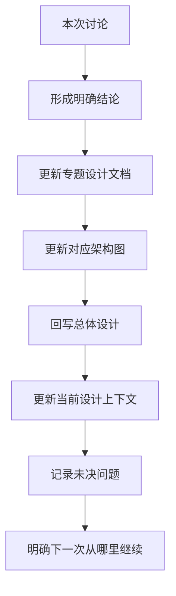

# 设计与文档协作约定

## 1. 文档服务谁

EDI Nexus 的文档首先服务于项目设计者本人。

AI、Codex、开发人员需要能够看懂，但不能为了方便 AI 而把文档写成只有机器容易消费、人却难读的形式。

判断一份文档是否合格的标准：

> 隔一个月重新打开，不依赖聊天记录，也能大致知道为什么这么设计、现在做到哪里、下一步做什么。

## 2. 每次讨论后的固定动作

每次形成重要设计结论后，按下面顺序收尾：



## 3. 文档层级

### 第一层：总体设计

文件：

`docs/00-EDI-Nexus-总体设计.md`

作用：

- 项目地图
- 大方向
- 当前能力边界
- 已确认结论
- 未确认事项

不在这里写大量类、表、字段、配置细节。

### 第二层：当前设计上下文

文件：

`docs/01-当前设计上下文.md`

作用：

- 快速恢复上下文
- 记录当前阶段
- 已完成什么
- 正在讨论什么
- 下一步是什么
- 哪些问题尚未决定

### 第三层：专题设计

根据实际业务能力拆分，例如：

```text
functional-design/
├── 合作方管理.md
├── 接入管理.md
├── 消息处理.md
├── 转换与路由.md
├── 发送管理.md
├── 失败与重试.md
├── 消息查询与追踪.md
└── 平台运行管理.md
```

是否最终采用这些文件名，要等功能设计后决定。

### 第四层：架构与详细设计

只有业务边界清楚后，才拆：

- 总体架构
- 模块边界
- 服务边界
- 消息模型
- 数据模型
- 一致性
- 幂等
- 状态机
- 接口
- 部署

## 4. 图的使用规则

不是每段内容都强行画图。

以下内容优先使用图：

| 要说明的问题 | 推荐图 |
| --- | --- |
| 系统整体是什么 | 总体架构图 |
| 模块之间什么关系 | 模块关系图 |
| 一条消息怎么走 | 流程图 |
| 多个系统怎么交互 | 时序图 |
| 状态如何变化 | 状态流转图 |
| 最后怎么部署 | 部署图 |

默认优先使用 Mermaid，方便直接跟随 Markdown 进入 Git 版本管理。

## 5. 文档语言规则

### 推荐

```text
Reception（接入模块）

作用：
负责接收外部系统的数据，并把外部协议差异隔离在系统边界。
```

### 不推荐

只写：

```text
采用高内聚低耦合的事件驱动云原生架构。
```

如果必须使用“解耦”“事件驱动”“幂等”等术语，需要紧接着解释在当前系统中具体是什么意思。

## 6. 重要决策单独记录

重要架构决定放到：

`docs/decisions/`

记录的不只是“选了什么”，还要记录：

- 背景
- 为什么需要决定
- 有哪些方案
- 各自优缺点
- 当前决定
- 哪些条件变化后需要重新评估

## 7. 未决问题允许长期存在

设计过程中不要求每个问题马上有答案。

统一使用：

`未确定`

或放入“未决问题”章节。

不允许为了让文档显得完整而虚构答案。

## 8. AI 的角色

AI 可以：

- 帮助整理需求
- 提醒遗漏
- 比较方案
- 查资料
- 画图
- 写初版文档
- 检查前后矛盾
- 辅助落代码
- 辅助测试

但核心架构决策由项目设计者确认。

目标是：

> AI 帮助设计，而不是 AI 替代设计。
