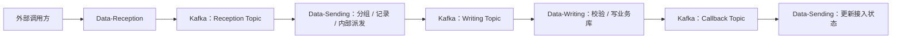

# 旧版 Data Exchange 架构复盘摘要

> 本文只保留旧系统中对 EDI Nexus 新版设计最有价值的结论。  
> 完整旧版分析来自 2026-10 的 Legacy Data Exchange Architecture Review。

## 1. 旧系统真实定位

旧版 `Micro-DataExchangeService` 是一套以仓储出库订单接入为核心的数据交换骨架。

目前源码中最完整的场景是：

`DSO / TUMISH / 1.0 / JSON`

真实主链不是简单的 Reception → Writing → Sending，而是：



其中 `Data-Sending` 的名字容易产生误解。当前代码中它主要承担内部派发、接入记录和状态回执，不是一个完整的外部 Partner 发送服务。

## 2. 值得新版继承的思想

### 2.1 接入与处理分离

外部 HTTP 请求并不直接完成业务库写入。

这是一个值得保留的边界：

```text
外部协议
    ↓
接入边界
    ↓
内部统一消息
    ↓
业务处理
```

### 2.2 把合作方差异隔离出去

旧版已经通过 Strategy / Handler 等方式区分：

- owner / 货主
- method / 业务场景
- version / 版本

新版应继续保留“差异隔离”的思想，但不一定继续照搬原来的类层次。

### 2.3 业务校验与系统校验分离

旧版区分：

- 报文本身是否正确
- 当前系统状态是否允许处理

这个职责划分仍然有价值。

### 2.4 固定流程 + 可替换处理

旧版通过模板式 Handler 固定处理顺序。

新版可以保留：

> 主流程清晰，差异步骤可替换。

### 2.5 异步解耦

Kafka 在旧版不是摆设，实际承担了不同阶段之间的异步传递。

新版可以保留异步解耦思想，但 Kafka 应该放在哪里，需要重新根据新版功能和可靠性要求设计。

### 2.6 状态回流

旧版已经有“接入记录 → Writing 完成 → 回调更新状态”的意识。

新版需要把它升级成真正的消息生命周期和追踪体系。

## 3. 旧系统主要问题

### 3.1 模块边界不够清楚

Sending 同时承担：

- 接入记录
- 消息分组
- 内部派发
- 回执状态更新

新版需要重新定义模块名称和职责。

### 3.2 路由机制不统一

Reception、Writing、Sending 各自使用不同的注册 / 路由方式。

新增场景需要修改多个地方，容易产生不一致。

### 3.3 业务模型重复

存在重复 DTO / Revert / DSOBean 等模型。

新版需要统一消息契约和模型边界。

### 3.4 幂等不足

旧版大致是：

```text
先查 Redis
    ↓
不存在
    ↓
写数据库
    ↓
再写 Redis
```

在并发、多实例和异常情况下不能真正保证只处理一次。

### 3.5 多阶段一致性不足

数据库、Redis、Kafka 发送、Kafka 消费确认是多个独立成功点。

可能出现：

- 已经写库，但没有回执
- 已经写库，但 Redis 更新失败
- 已经产生副作用，但消费位置没有正确处理
- 状态一直停在处理中

### 3.6 失败闭环不完整

旧版存在：

- 异常被吞
- 失败后仍可能确认消费
- 没有完整失败状态
- 没有可靠的重试 / Dead Letter / 人工恢复闭环

### 3.7 可观测性不足

已有普通日志，但缺少贯穿整条消息生命周期的：

- messageId
- traceId
- 当前阶段
- 处理耗时
- 失败原因
- 重试次数
- 业务成功率
- 消息积压
- 分布式调用追踪

## 4. Kubernetes 时代必须重新考虑的问题

旧版没有明显依赖 JVM 本地订单状态，这是好事。

但多 Pod 会放大：

- 并发重复消息
- 业务幂等
- Kafka 重投
- Consumer Rebalance
- Pod 在阶段中途终止
- DB / Redis / Kafka 状态不一致

所以新版不能只做到“能部署进 Kubernetes”，而要真正做到：

> Pod 可以随时重启、扩容、缩容，但业务消息仍然可追踪、可恢复、不会因为扩容而重复产生错误副作用。

## 5. 对新版的核心结论

### 保留

- 职责分离
- 差异隔离
- 统一消息
- 两级校验
- 异步解耦思想
- 结果回流

### 重新设计

- 消息生命周期
- 模块边界
- 路由机制
- 消息契约
- 幂等
- 一致性
- 重试
- 多实例
- 日志与监控

### 不直接继承

- 吞异常后仍认为处理成功
- Redis 先查后写作为唯一去重方案
- 依赖类名反射识别业务类型
- 多份重复 DTO
- 缺少最终失败闭环的消息处理方式

旧系统的价值主要是：

> 它已经形成了“平台化数据交换”的雏形。  
> 新版要继承这个方向，但重新构建可靠性、管理能力和运行能力。
